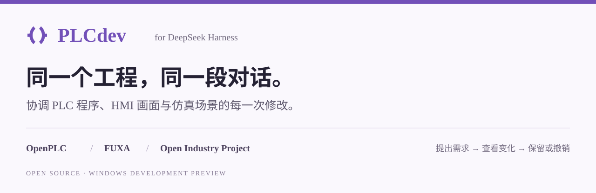
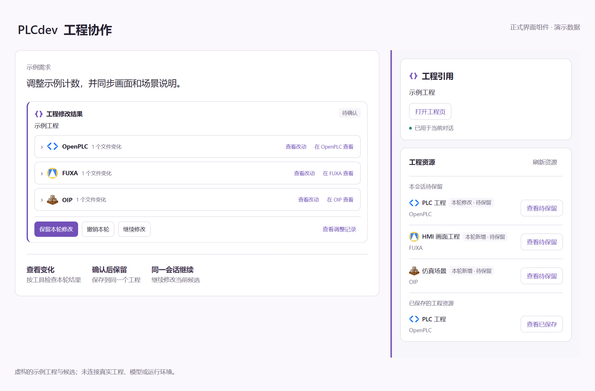
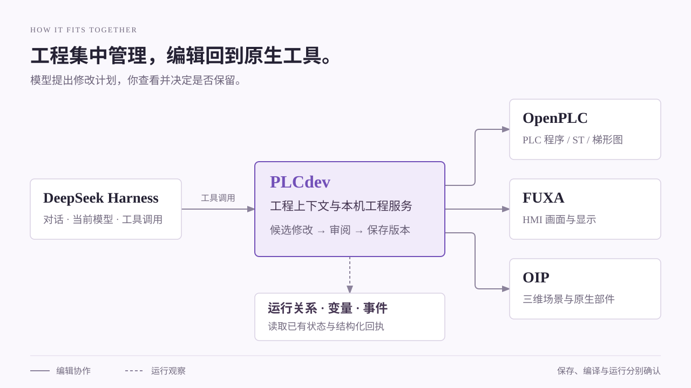
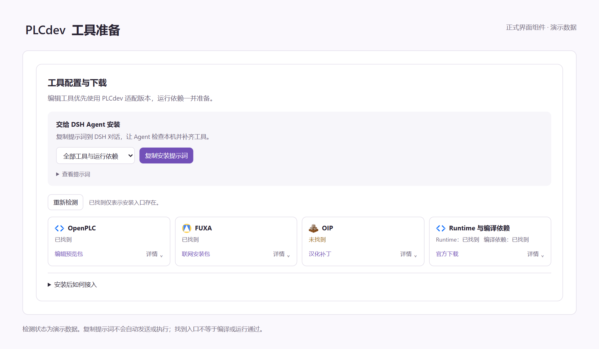

<p align="center">
  
</p>

# PLCdev for DeepSeek Harness

**让 PLC 程序、HMI 画面与仿真场景，在同一个工程、同一段对话里协同修改。**

PLCdev 是 DeepSeek Harness（DSH）的开源工程插件，面向 PLC 学习、教学演示和本机开发。你用自然语言提出需求，插件整理各工具的修改结果；你可以查看变化、打开原生工具检查，再决定保留或撤销本轮修改。

[](https://github.com/HellsegaMIMIC/dsh-plcdev/actions/workflows/source-checks.yml)
[](https://github.com/HellsegaMIMIC/dsh-plcdev/releases/tag/v0.5.10-preview.1)
[](docs/INSTALL.md)
[](LICENSE)

[下载预览版](https://github.com/HellsegaMIMIC/dsh-plcdev/releases/tag/v0.5.10-preview.1) · [安装与接入](docs/INSTALL.md) · [功能边界](docs/STATUS.md) · [更新记录](CHANGELOG.md) · [反馈问题](https://github.com/HellsegaMIMIC/dsh-plcdev/issues)

> 当前为 **Windows 开发预览**。维护者已验证特定环境下的三工具编辑、查看、保留与撤销闭环；新电脑完整安装和最新版本真实 Runtime 联调仍需分别验证。

## 一次对话，协调三种工程资源

| 工具 | 在工程中负责什么 | 当前支持的修改 |
| --- | --- | --- |
| **OpenPLC** | PLC 程序 | POU、变量及受支持的 ST／梯形图编辑，实际文件与梯形图差异查看 |
| **FUXA** | HMI 操作画面 | 受支持的文字、名称、只读数值显示及声明接口修改 |
| **Open Industry Project（OIP）** | 三维仿真场景 | 创建场景、编辑原生部件与信号绑定；运行联动另行验证 |

各工具保留自己的原生编辑能力。PLCdev 把工程上下文、候选修改、审阅结果和运行状态放到一起，让每次调整都有明确归属。



*正式 0.5.10 界面组件，以虚构的“示例工程”渲染。所有截图均使用演示数据，不包含真实项目、会话或本机路径。它们展示界面，不代表真实模型生成或运行验收。详见[图片说明](docs/MEDIA.md)。*

## 从提出需求到确认修改

1. **关联工程**：在 DSH 新会话中开启 PLCdev，选择或创建工程。
2. **提出需求**：使用支持兼容工具调用的当前模型，描述需要调整的程序、画面或场景。
3. **查看变化**：结果卡汇总各工具改动，展开文件或梯形图差异，也可在原生工具中查看。
4. **决定保留或撤销**：继续修改当前候选；确认后保存到同一工程，继续原会话。

例如，可以从一个小需求开始：

> 在当前工程中增加一个只读计数显示，并说明这次修改涉及哪些文件。

“本轮待保留”与“已保存的工程资源”分别显示。**撤销只丢弃尚未保留的候选，不会回滚已保存版本。** 原生编辑器中的未保存草稿仍由原生工具管理。

## 工程、编辑与运行各有归属



- **工程集中管理**：按名称或路径搜索，筛选 PLC／HMI／仿真内容，按保存文件的最近修改时间排序。
- **模型由 DSH 管理**：工程上下文与模型选择分开；生成能力取决于宿主和模型的工具调用支持。
- **修改过程可检查**：结果卡、调整记录和资源区对应同一个工程与候选版本。
- **运行状态分开核对**：“运行与监视”分别展示保存版本、编译、Runtime 与工具通信；变量和运行事件同区查看。

保存工程不会自动替换正在运行的程序。当前事件汇总已有结构化回执与状态，不代表采集了所有原生工具日志。进一步了解[架构与归属](docs/ARCHITECTURE.md)。

## 开始使用

### 试用插件

到 [v0.5.10-preview.1](https://github.com/HellsegaMIMIC/dsh-plcdev/releases/tag/v0.5.10-preview.1) 下载源码 ZIP 与插件 TGZ，按[安装说明](docs/INSTALL.md)准备本机工程服务并接入 DSH。

插件 TGZ 包含插件界面与代码，工程服务需要匹配的源码树；DSH、原生编辑工具及 Runtime 分别安装。仅安装编辑器 EXE 不足以提供所有工程服务。当前 OIP 适配有固定版本与本机目录约束，试用前请核对安装说明。



*正式工具准备组件，检测状态为演示数据。可以复制安装提示词到 DSH 对话；复制不会自动发送或执行。找到工具入口也不等于编译或运行已通过。*

| 适配工具 | 下载与配置 |
| --- | --- |
| OpenPLC Editor | [DSH 适配源码与编辑预览](https://github.com/HellsegaMIMIC/openplc-editor-dsh) |
| FUXA | [中文补丁与固定版本安装资料](https://github.com/HellsegaMIMIC/fuxa-zh) |
| Open Industry Project | [中文补丁与版本说明](https://github.com/HellsegaMIMIC/open-industry-project-zh) |
| OpenPLC Runtime | [官方 Runtime](https://github.com/Autonomy-Logic/openplc-runtime)；Windows 编译依赖见安装说明 |

### 从源码开发

在仓库根目录执行（维护者基线：Node 25、Python 3.13、DSH 0.2.2）：

```powershell
npm ci
npm run build
npm test
python -B -X utf8 tools/verify_source_release.py .
```

构建与离线测试不要求模型账户，也不会运行真实 PLC。测试结果与构建身份见发行源码中的 `validation.json` 和 `SOURCE-MANIFEST.json`；原生工具集成需要额外依赖。

```text
software/dsh-plcdev/    DSH 插件、工程界面与测试
software/workbench/     本机工程服务及兼容能力
tools/                 工程操作、适配与验证工具
config/                配置模板与版本约束
docs/                  安装、架构、隐私与验收边界
```

## 当前范围

本仓库发布插件、工程服务、适配源码、构建锁与测试。默认工程目录为空，**不包含用户工程、PLC 工艺程序、HMI 画面、OIP 教学场景、会话或密钥**。用于测试的合成梯形图样本不会注册为用户工程。

| 已有实现与限定验证 | 仍需独立验证或开发 |
| --- | --- |
| 同工程、同会话的三工具候选、查看、保留与撤销 | 新电脑完整工具链安装、任意模型与复杂工程兼容 |
| 工程筛选、资源状态、修改记录与梯形图差异 | 原生手工草稿自动回收、历史保存版本回滚 |
| 运行关系、变量与结构化事件界面 | 最新构建的完整 Runtime 故障恢复、实时性与硬件 |

EEZ Studio 的统一候选适配仍在开发，未包含在 0.5.10 发行中。详细证据范围见[开发状态](docs/STATUS.md)。本项目面向学习与开发，软件停止、HMI、网络和本项目均不得作为人员安全功能。

## 参与项目

欢迎提交安装体验、界面问题和可复现的缺陷。提问时附上版本、操作步骤与去除私人信息的截图；请勿上传工程凭据或账号密钥。

[贡献指南](CONTRIBUTING.md) · [隐私说明](docs/PRIVACY.md) · [安全问题](SECURITY.md) · [第三方来源](THIRD_PARTY_NOTICES.md)

原创部分采用 **GPL-3.0-only**。DSH、OpenPLC、FUXA、OIP 及其他第三方代码和产品标志保留原许可与权利；本项目是社区集成，不代表官方背书。
