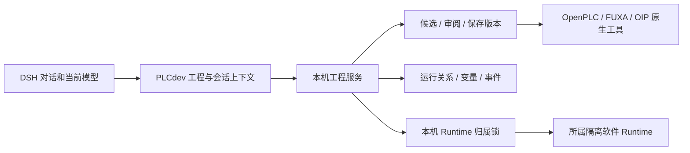

# 架构与归属

DSH 管理聊天、模型和工具调用；PLCdev 管理工程 UUID、保存版本、候选事务和工具窗口身份。切换模型不改变工程或丢失候选修订，不创建第二套原生编辑语义。

模型提交版本化结构计划，服务核对工程、来源和本轮意图后，通过各工具已支持的编辑器能力生成候选。“保留”保存到同一工程的新版本；“撤销”废弃本轮未保留候选。旧预览保留历史归属，不能当作当前工程。

工具窗口与 DSH 的跳转带工程和版本身份。编辑器已有未保存草稿、待确认弹窗或运行中的仿真不会被静默覆盖。OpenPLC 的会话桥复用 DSH 模型服务，不复制账号密钥。

Runtime 是运行依赖，不是 AI 文件修改对象。工程保存、编译产物、装载程序、RUN/STOP 和画面/场景通信分别判断。事件服务只读取已有结构化回执和观察状态；无新证据不标记恢复，读事件不自动启动、重连或重试工具。

本机代理提供固定操作白名单和工程归属校验。敏感浏览器读取遵守同源约束，桌面读取核对宿主 owner；未知结果保留原请求记录，不盲重放。普通 Shell 文件修改不自动成为 PLCdev 候选。
