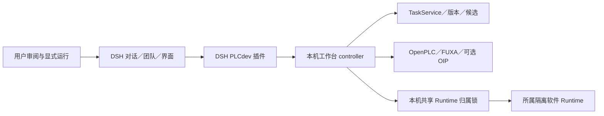

# 架构与归属

DSH 管原生对话、成员、消息和团队任务；工程服务管 UUID、保存版本、候选事务、执行与证据。它们不是同一个对象，不另建竞争的候选事实源。

单助手工程工具通过宿主统一工具注册提供给当前模型。`project-context.mjs` 根据可信会话和轮次固定工程、用户需求与修订意图，执行时核对实际工具调用身份、绑定和源版本；业务状态不再由专用模型适配器建立。切换模型不重发已提交任务，同一轮内模型或用户需求变化使旧提交上下文失效。

当前宿主模型通过 `planJson` 提交版本化结构计划，插件保存原计划、实际模型路由和请求编号；后台 `generate_from_plan` 验证计划并生成原生候选，不发起供应商请求。标题修订基于上一版内部规格，只替换明确要求的标题，新版成功发布才替代父候选。失败或结果未知时保留原候选，并按原编号核对。团队工作流仍保留原模型路由和角色门禁，尚未迁移。

聊天历史由宿主管理，插件只增加受控工程规格和有限修订摘要，不向模型投影内部完整规格、原工程文件或凭据。普通文件／Shell 工具受宿主自身权限管理，不能将其文件修改回执当作插件候选。

插件经本机接口代理白名单操作。浏览器请求遵守同源检查；没有 Origin 的桌面转发请求须通过宿主 authenticated owner 校验。浏览器不持有私密 PLC 写入桥凭据；请求核对工程、会话、配置／程序、时效、序号和遥测。未知结果不盲目重放。

模型修改先成为可审阅候选，保留形成新工程。切换页面、停用插件或关闭 DSH 不代表停止独立 Runtime。默认不下载到实体控制器或操作真实 I/O。
