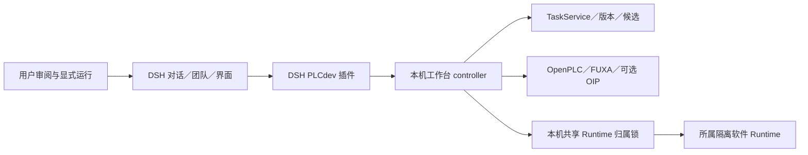

# 架构与归属

DSH 管原生对话、成员、消息和团队任务；工程服务管 UUID、保存版本、候选事务、执行与证据。它们不是同一个对象，不另建竞争的候选事实源。

插件经本机同源接口代理白名单操作。浏览器不持有私密 PLC 写入桥凭据；请求核对工程、会话、配置／程序、时效、序号和遥测。未知结果不盲目重放。

模型修改先成为可审阅候选，保留形成新工程。切换页面、停用插件或关闭 DSH 不代表停止独立 Runtime。默认不下载到实体控制器或操作真实 I/O。
